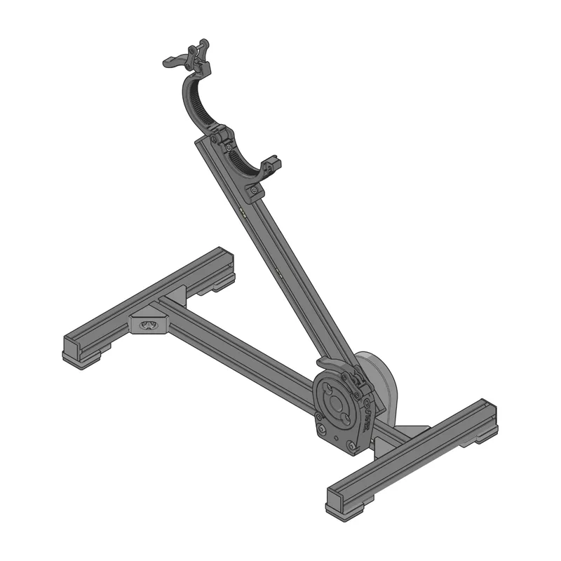
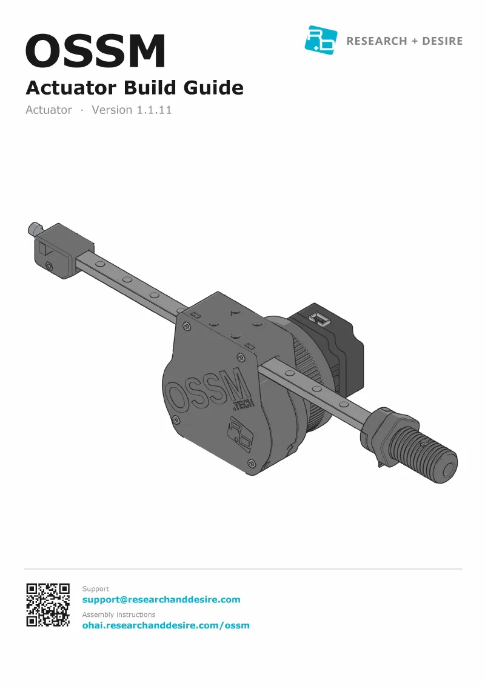
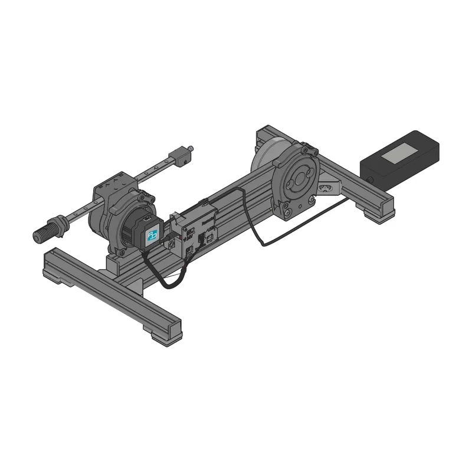
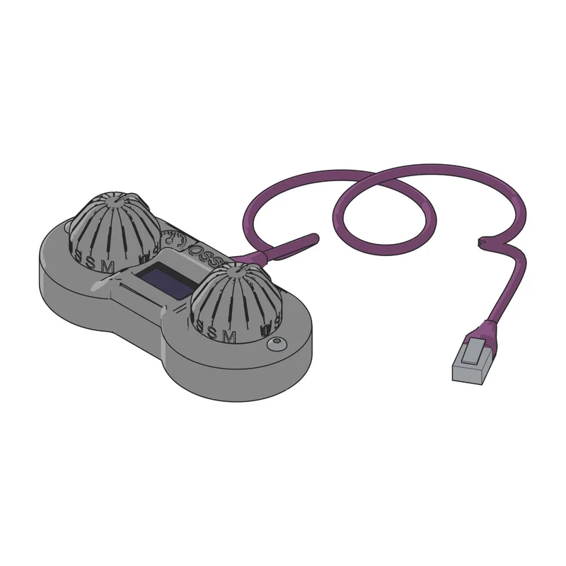
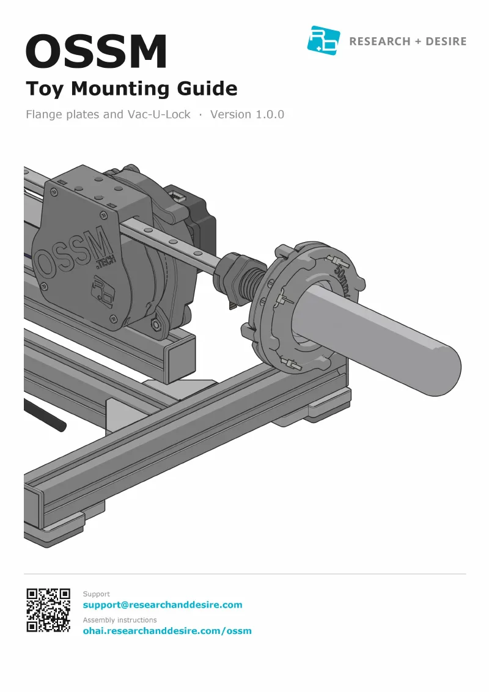
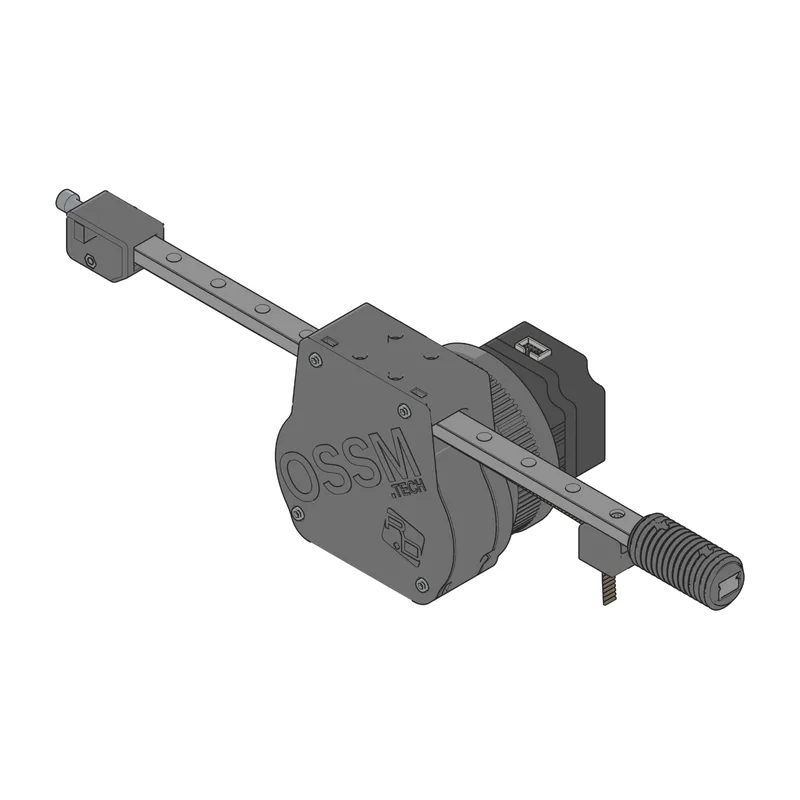
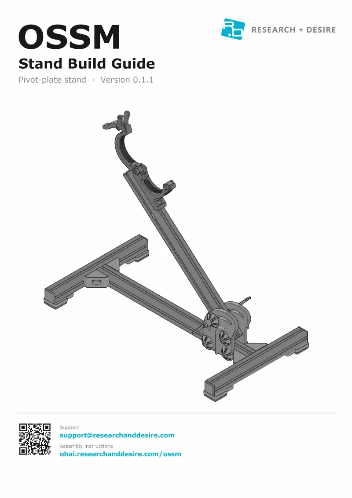

Build an OSSM in this order: the stand, the actuator, the wiring, then the wired
remote. Each guide starts where the one before it ends. The toy mounting guide
then shows how to mount a toy on the finished OSSM.

## Current guides

{/* Stand 1.1 (the BaseClamp stand) is hidden behind the PostHog flag
ossm-baseclamp-stand until it launches. Readers without the flag see Stand 1.0.
At launch, keep the show="on" content, delete the show="off" content and
remove the FeatureFlag wrappers. */}

<FeatureFlag flag="ossm-baseclamp-stand" show="off">

<Photo caption={<a href="https://github.com/researchanddesire/OSSM/blob/main/hardware/build-guides/stand-1.0.pdf" style={{ textDecoration: "underline", textUnderlineOffset: "3px" }}>Stand 1.0</a>}>

</Photo>

</FeatureFlag>

<FeatureFlag flag="ossm-baseclamp-stand">

<Photo caption={<a href="https://github.com/researchanddesire/OSSM/blob/main/hardware/build-guides/stand-1.1.pdf" style={{ textDecoration: "underline", textUnderlineOffset: "3px" }}>Stand 1.1</a>}>

</Photo>

</FeatureFlag>

<Photo caption={<a href="https://github.com/researchanddesire/OSSM/blob/main/hardware/build-guides/actuator-1.1.pdf" style={{ textDecoration: "underline", textUnderlineOffset: "3px" }}>Actuator 1.1</a>}>

</Photo>

<Photo caption={<a href="https://github.com/researchanddesire/OSSM/blob/main/hardware/build-guides/wiring-1.0.pdf" style={{ textDecoration: "underline", textUnderlineOffset: "3px" }}>Wiring 1.0</a>}>

</Photo>

<Photo caption={<a href="https://github.com/researchanddesire/OSSM/blob/main/hardware/build-guides/remote-1.0.pdf" style={{ textDecoration: "underline", textUnderlineOffset: "3px" }}>Wired Remote 1.0</a>}>

</Photo>

<Photo caption={<a href="https://github.com/researchanddesire/OSSM/blob/main/hardware/build-guides/toy-mounting-1.0.pdf" style={{ textDecoration: "underline", textUnderlineOffset: "3px" }}>Toy Mounting 1.0</a>}>

</Photo>

<FeatureFlag flag="ossm-baseclamp-stand" show="off">

| Guide | Edition | Covers | PDF |
| --- | --- | --- | --- |
| Stand Build Guide | 1.0 | The PitClamp stand: the 3030 extrusion frame, a pivot plate and PitClamp on the body, and the PitClamp Mini V1.1 on the arm. | [View](https://github.com/researchanddesire/OSSM/blob/main/hardware/build-guides/stand-1.0.pdf) · [Download](https://github.com/researchanddesire/OSSM/raw/main/hardware/build-guides/stand-1.0.pdf) |
| Actuator Build Guide | 1.1 | The servo in its motor ring, the MGN12H rail, the GT2 belt with its tensioner, and the 24 mm Clamping Thread end effector with its belt clamp ring and lock nut. Uses the kit's two printed jigs, a bearing jig and a 3.8 mm pulley spacer ([print files](https://github.com/researchanddesire/OSSM/tree/main/hardware/cad/jigs)). The same actuator fits every stand. | [View](https://github.com/researchanddesire/OSSM/blob/main/hardware/build-guides/actuator-1.1.pdf) · [Download](https://github.com/researchanddesire/OSSM/raw/main/hardware/build-guides/actuator-1.1.pdf) |
| Wiring Guide | 1.0 | The V2.3 board in its PCB box on the arm, the motor harness from the servo to the board, and the 24 V power supply. | [View](https://github.com/researchanddesire/OSSM/blob/main/hardware/build-guides/wiring-1.0.pdf) · [Download](https://github.com/researchanddesire/OSSM/raw/main/hardware/build-guides/wiring-1.0.pdf) |
| Wired Remote Guide | 1.0 | The Remote V2 board in its printed body and cover, two knobs, and the purple CAT6 cable into the OSSM's REMOTE port. | [View](https://github.com/researchanddesire/OSSM/blob/main/hardware/build-guides/remote-1.0.pdf) · [Download](https://github.com/researchanddesire/OSSM/raw/main/hardware/build-guides/remote-1.0.pdf) |
| Toy Mounting Guide | 1.0 | Two ways to mount a toy on the 24 mm threaded end effector, each locked by a lock nut: the flange base and flange ring tied through their holes with cable ties or laced round their hooks with paracord, or the Vac-U-Lock adapter, and how to check the toy is held. | [View](https://github.com/researchanddesire/OSSM/blob/main/hardware/build-guides/toy-mounting-1.0.pdf) · [Download](https://github.com/researchanddesire/OSSM/raw/main/hardware/build-guides/toy-mounting-1.0.pdf) |

The wiring and wired remote guides show the PitClamp stand.

</FeatureFlag>

<FeatureFlag flag="ossm-baseclamp-stand">

| Guide | Edition | Covers | PDF |
| --- | --- | --- | --- |
| Stand Build Guide | 1.1 | The 1-arm PitClamp stand: the 3030 extrusion frame, the keyed lower PitClamp and its passive pivot on the base rail, and the PitClamp Mini V1.1 on the arm. It uses only screw sizes found elsewhere in the OSSM kit. | [View](https://github.com/researchanddesire/OSSM/blob/main/hardware/build-guides/stand-1.1.pdf) · [Download](https://github.com/researchanddesire/OSSM/raw/main/hardware/build-guides/stand-1.1.pdf) |
| Actuator Build Guide | 1.1 | The servo in its motor ring, the MGN12H rail, the GT2 belt with its tensioner, and the 24 mm Clamping Thread end effector with its belt clamp ring and lock nut. Uses the kit's two printed jigs, a bearing jig and a 3.8 mm pulley spacer ([print files](https://github.com/researchanddesire/OSSM/tree/main/hardware/cad/jigs)). The same actuator fits every stand. | [View](https://github.com/researchanddesire/OSSM/blob/main/hardware/build-guides/actuator-1.1.pdf) · [Download](https://github.com/researchanddesire/OSSM/raw/main/hardware/build-guides/actuator-1.1.pdf) |
| Wiring Guide | 1.0 | The V2.3 board in its PCB box on the arm, the motor harness from the servo to the board, and the 24 V power supply. | [View](https://github.com/researchanddesire/OSSM/blob/main/hardware/build-guides/wiring-1.0.pdf) · [Download](https://github.com/researchanddesire/OSSM/raw/main/hardware/build-guides/wiring-1.0.pdf) |
| Wired Remote Guide | 1.0 | The Remote V2 board in its printed body and cover, two knobs, and the purple CAT6 cable into the OSSM's REMOTE port. | [View](https://github.com/researchanddesire/OSSM/blob/main/hardware/build-guides/remote-1.0.pdf) · [Download](https://github.com/researchanddesire/OSSM/raw/main/hardware/build-guides/remote-1.0.pdf) |
| Toy Mounting Guide | 1.0 | Two ways to mount a toy on the 24 mm threaded end effector, each locked by a lock nut: the flange base and flange ring tied through their holes with cable ties or laced round their hooks with paracord, or the Vac-U-Lock adapter, and how to check the toy is held. | [View](https://github.com/researchanddesire/OSSM/blob/main/hardware/build-guides/toy-mounting-1.0.pdf) · [Download](https://github.com/researchanddesire/OSSM/raw/main/hardware/build-guides/toy-mounting-1.0.pdf) |

The wiring and wired remote guides show the PitClamp stand as built in Stand
1.0. Its clamp on the base rail looks slightly different from the one in Stand 1.1;
the wiring and remote steps are the same.

</FeatureFlag>

## Earlier hardware

Use these guides for an OSSM built with the earlier parts.

<FeatureFlag flag="ossm-baseclamp-stand">

<Photo caption={<a href="https://github.com/researchanddesire/OSSM/blob/main/hardware/build-guides/stand-1.0.pdf" style={{ textDecoration: "underline", textUnderlineOffset: "3px" }}>Stand 1.0</a>}>

</Photo>

</FeatureFlag>

<Photo caption={<a href="https://github.com/researchanddesire/OSSM/blob/main/hardware/build-guides/actuator-1.0.pdf" style={{ textDecoration: "underline", textUnderlineOffset: "3px" }}>Actuator 1.0</a>}>

</Photo>

<Photo caption={<a href="https://github.com/researchanddesire/OSSM/blob/main/hardware/build-guides/stand-0.1.pdf" style={{ textDecoration: "underline", textUnderlineOffset: "3px" }}>Stand 0.1</a>}>

</Photo>

<Photo caption={<a href="https://github.com/researchanddesire/OSSM/blob/main/hardware/build-guides/stand-0.0.pdf" style={{ textDecoration: "underline", textUnderlineOffset: "3px" }}>Stand 0.0</a>}>

</Photo>

<FeatureFlag flag="ossm-baseclamp-stand" show="off">

| Guide | Edition | Covers | PDF |
| --- | --- | --- | --- |
| Actuator Build Guide | 1.0 | The same actuator with the earlier end effector: the 24 mm thread and a separate belt clamp. | [View](https://github.com/researchanddesire/OSSM/blob/main/hardware/build-guides/actuator-1.0.pdf) · [Download](https://github.com/researchanddesire/OSSM/raw/main/hardware/build-guides/actuator-1.0.pdf) |
| Stand Build Guide | 0.1 | The pivot-plate stand: two printed pivot plates with adjustable M6 handles, and the PitClamp Mini V1.1 on the arm. | [View](https://github.com/researchanddesire/OSSM/blob/main/hardware/build-guides/stand-0.1.pdf) · [Download](https://github.com/researchanddesire/OSSM/raw/main/hardware/build-guides/stand-0.1.pdf) |
| Stand Build Guide | 0.0 | The pivot-plate stand with the earlier PitClamp Mini kit, whose handle sits on a separate M4×12 pin. | [View](https://github.com/researchanddesire/OSSM/blob/main/hardware/build-guides/stand-0.0.pdf) · [Download](https://github.com/researchanddesire/OSSM/raw/main/hardware/build-guides/stand-0.0.pdf) |

</FeatureFlag>

<FeatureFlag flag="ossm-baseclamp-stand">

| Guide | Edition | Covers | PDF |
| --- | --- | --- | --- |
| Actuator Build Guide | 1.0 | The same actuator with the earlier end effector: the 24 mm thread and a separate belt clamp. | [View](https://github.com/researchanddesire/OSSM/blob/main/hardware/build-guides/actuator-1.0.pdf) · [Download](https://github.com/researchanddesire/OSSM/raw/main/hardware/build-guides/actuator-1.0.pdf) |
| Stand Build Guide | 1.0 | The PitClamp stand with the earlier 3-hole lower clamp base, held by M6×30 screws, and a separate clasp handle. | [View](https://github.com/researchanddesire/OSSM/blob/main/hardware/build-guides/stand-1.0.pdf) · [Download](https://github.com/researchanddesire/OSSM/raw/main/hardware/build-guides/stand-1.0.pdf) |
| Stand Build Guide | 0.1 | The pivot-plate stand: two printed pivot plates with adjustable M6 handles, and the PitClamp Mini V1.1 on the arm. | [View](https://github.com/researchanddesire/OSSM/blob/main/hardware/build-guides/stand-0.1.pdf) · [Download](https://github.com/researchanddesire/OSSM/raw/main/hardware/build-guides/stand-0.1.pdf) |
| Stand Build Guide | 0.0 | The pivot-plate stand with the earlier PitClamp Mini kit, whose handle sits on a separate M4×12 pin. | [View](https://github.com/researchanddesire/OSSM/blob/main/hardware/build-guides/stand-0.0.pdf) · [Download](https://github.com/researchanddesire/OSSM/raw/main/hardware/build-guides/stand-0.0.pdf) |

</FeatureFlag>

## Editions

Each guide's cover shows its full version number, such as 1.0.14 for Stand
1.0. The first number is the hardware version, the second counts compatible
part changes, and the third counts documentation corrections. A file always
holds the latest corrections for its edition.

The parts for these builds are in the [bill of materials](/ossm/bom), and the
motor harness has its own [wiring diagram](/ossm/cable-harnesses). The PDFs
are kept in the
[OSSM repository](https://github.com/researchanddesire/OSSM/tree/main/hardware/build-guides).
For help, email [support@researchanddesire.com](mailto:support@researchanddesire.com).
