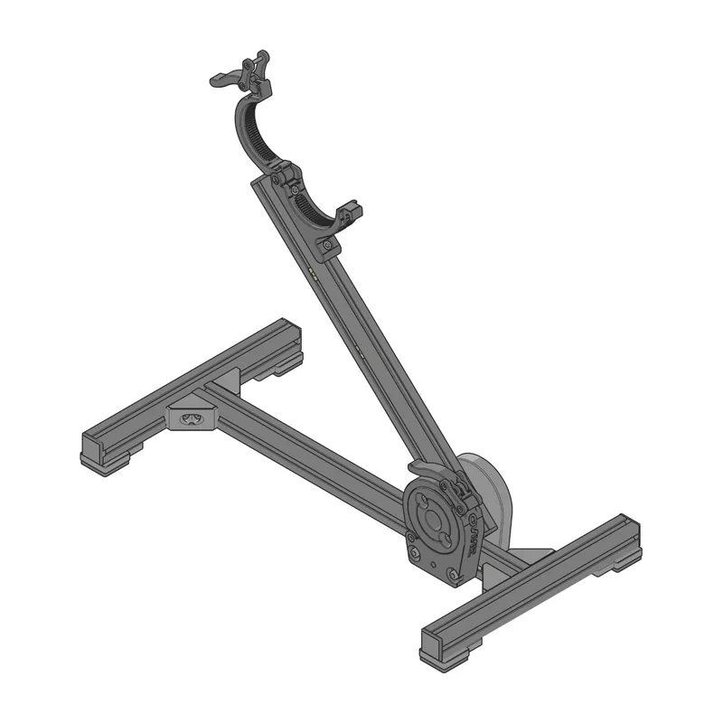
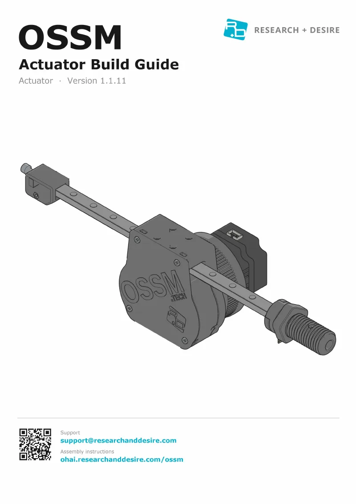
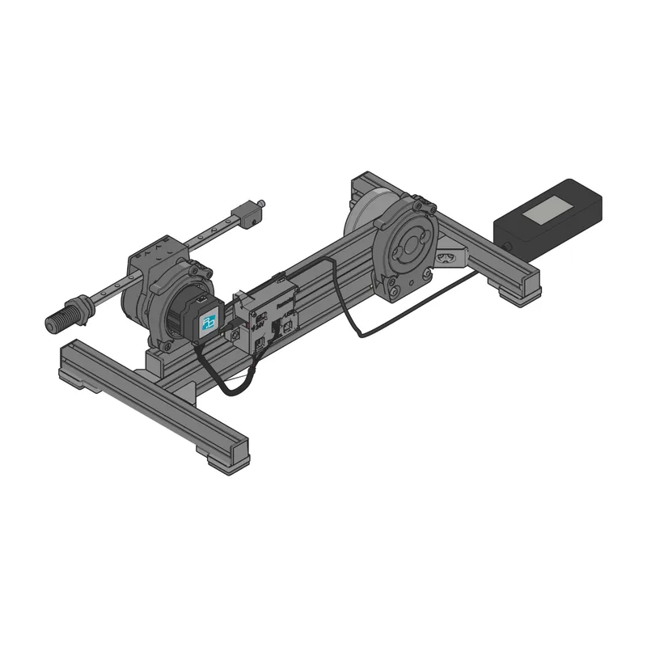
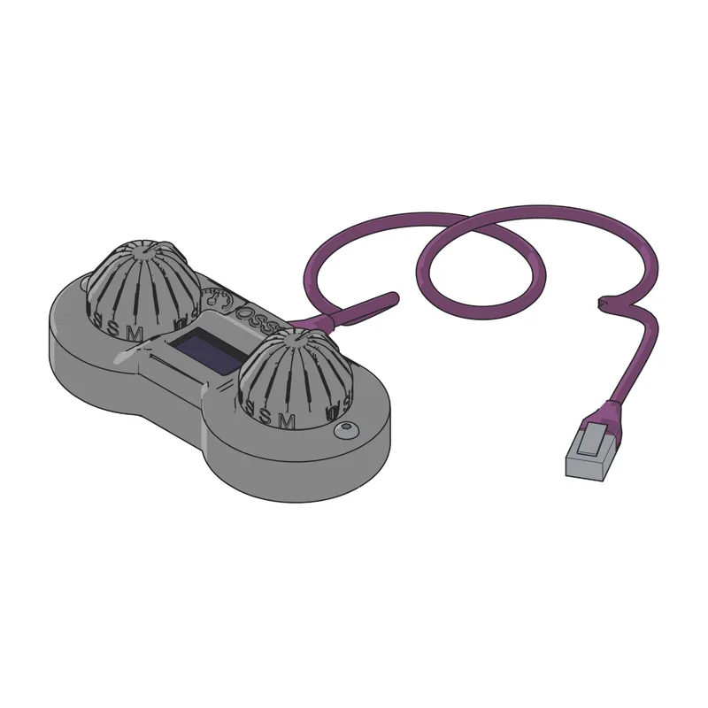
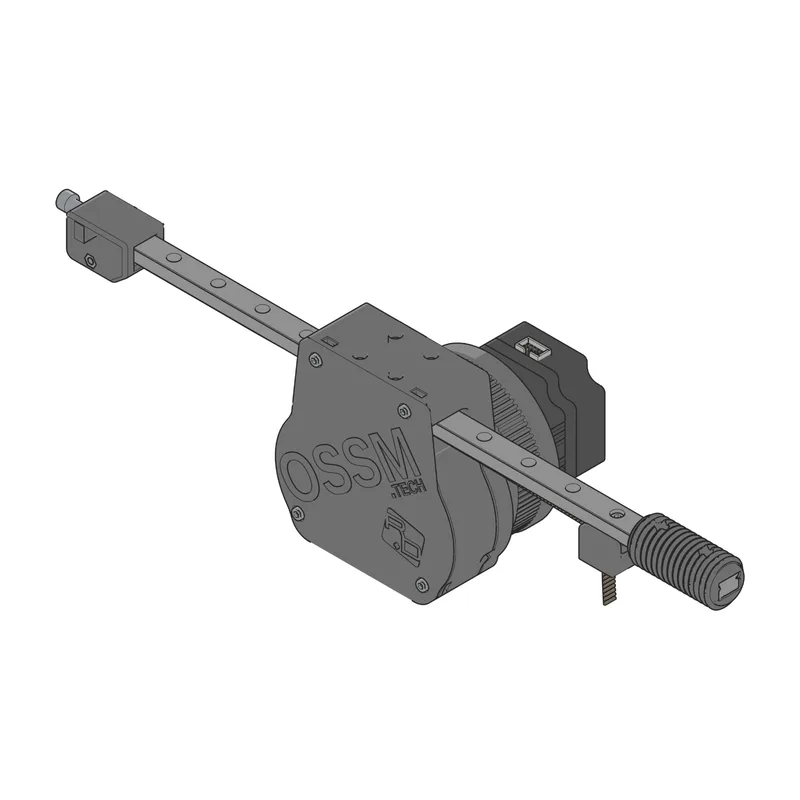
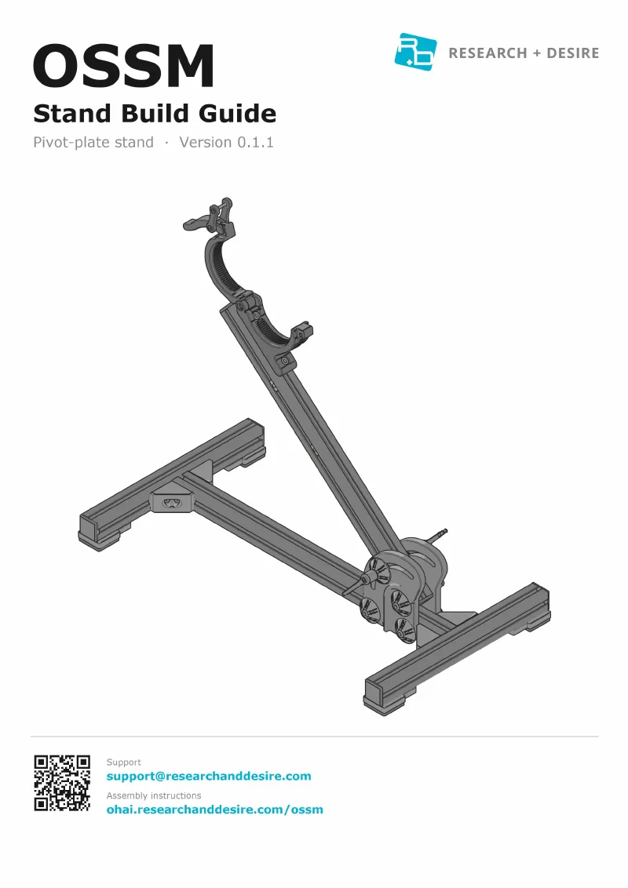

Build an OSSM in this order: the stand, the actuator, the wiring, then the wired
remote. Each guide starts where the one before it ends.

## Current guides

<Photo caption={<a href="https://github.com/researchanddesire/OSSM/blob/main/hardware/build-guides/stand-1.0.pdf" style={{ textDecoration: "underline", textUnderlineOffset: "3px" }}>Stand 1.0</a>}>

</Photo>

<Photo caption={<a href="https://github.com/researchanddesire/OSSM/blob/main/hardware/build-guides/actuator-1.1.pdf" style={{ textDecoration: "underline", textUnderlineOffset: "3px" }}>Actuator 1.1</a>}>

</Photo>

<Photo caption={<a href="https://github.com/researchanddesire/OSSM/blob/main/hardware/build-guides/wiring-1.0.pdf" style={{ textDecoration: "underline", textUnderlineOffset: "3px" }}>Wiring 1.0</a>}>

</Photo>

<Photo caption={<a href="https://github.com/researchanddesire/OSSM/blob/main/hardware/build-guides/remote-1.0.pdf" style={{ textDecoration: "underline", textUnderlineOffset: "3px" }}>Wired Remote 1.0</a>}>

</Photo>

| Guide | Edition | Covers | PDF |
| --- | --- | --- | --- |
| Stand Build Guide | 1.0 | The PitClamp stand: the 3030 extrusion frame, a pivot plate and PitClamp on the body, and the PitClamp Mini V1.1 on the arm. | [View](https://github.com/researchanddesire/OSSM/blob/main/hardware/build-guides/stand-1.0.pdf) · [Download](https://github.com/researchanddesire/OSSM/raw/main/hardware/build-guides/stand-1.0.pdf) |
| Actuator Build Guide | 1.1 | The servo in its motor ring, the MGN12H rail, the GT2 belt with its tensioner, and the 24 mm Clamping Thread end effector with its belt clamp ring and lock nut. The same actuator fits every stand. | [View](https://github.com/researchanddesire/OSSM/blob/main/hardware/build-guides/actuator-1.1.pdf) · [Download](https://github.com/researchanddesire/OSSM/raw/main/hardware/build-guides/actuator-1.1.pdf) |
| Wiring Guide | 1.0 | The V2.3 board in its PCB box on the arm, the motor harness from the servo to the board, and the 24 V power supply. | [View](https://github.com/researchanddesire/OSSM/blob/main/hardware/build-guides/wiring-1.0.pdf) · [Download](https://github.com/researchanddesire/OSSM/raw/main/hardware/build-guides/wiring-1.0.pdf) |
| Wired Remote Guide | 1.0 | The Remote V2 board in its printed body and cover, two knobs, and the purple CAT6 cable into the OSSM's REMOTE port. | [View](https://github.com/researchanddesire/OSSM/blob/main/hardware/build-guides/remote-1.0.pdf) · [Download](https://github.com/researchanddesire/OSSM/raw/main/hardware/build-guides/remote-1.0.pdf) |

The wiring and wired remote guides show the PitClamp stand.

## Earlier hardware

Use these guides for an OSSM built with the earlier parts.

<Photo caption={<a href="https://github.com/researchanddesire/OSSM/blob/main/hardware/build-guides/actuator-1.0.pdf" style={{ textDecoration: "underline", textUnderlineOffset: "3px" }}>Actuator 1.0</a>}>

</Photo>

<Photo caption={<a href="https://github.com/researchanddesire/OSSM/blob/main/hardware/build-guides/stand-0.1.pdf" style={{ textDecoration: "underline", textUnderlineOffset: "3px" }}>Stand 0.1</a>}>

</Photo>

<Photo caption={<a href="https://github.com/researchanddesire/OSSM/blob/main/hardware/build-guides/stand-0.0.pdf" style={{ textDecoration: "underline", textUnderlineOffset: "3px" }}>Stand 0.0</a>}>

</Photo>

| Guide | Edition | Covers | PDF |
| --- | --- | --- | --- |
| Actuator Build Guide | 1.0 | The same actuator with the earlier end effector: the 24 mm thread and a separate belt clamp. | [View](https://github.com/researchanddesire/OSSM/blob/main/hardware/build-guides/actuator-1.0.pdf) · [Download](https://github.com/researchanddesire/OSSM/raw/main/hardware/build-guides/actuator-1.0.pdf) |
| Stand Build Guide | 0.1 | The pivot-plate stand: two printed pivot plates with adjustable M6 handles, and the PitClamp Mini V1.1 on the arm. | [View](https://github.com/researchanddesire/OSSM/blob/main/hardware/build-guides/stand-0.1.pdf) · [Download](https://github.com/researchanddesire/OSSM/raw/main/hardware/build-guides/stand-0.1.pdf) |
| Stand Build Guide | 0.0 | The pivot-plate stand with the earlier PitClamp Mini kit, whose handle sits on a separate M4×12 pin. | [View](https://github.com/researchanddesire/OSSM/blob/main/hardware/build-guides/stand-0.0.pdf) · [Download](https://github.com/researchanddesire/OSSM/raw/main/hardware/build-guides/stand-0.0.pdf) |

## Editions

Each guide's cover shows its full version number, such as 1.0.14 for Stand
1.0. The first number is the hardware version, the second counts compatible
part changes, and the third counts documentation corrections. A file always
holds the latest corrections for its edition.

The parts for these builds are in the [bill of materials](/ossm/bom), and the
motor harness has its own [wiring diagram](/ossm/cable-harnesses). The PDFs
are kept in the
[OSSM repository](https://github.com/researchanddesire/OSSM/tree/main/hardware/build-guides).
For help, email [support@researchanddesire.com](mailto:support@researchanddesire.com).
